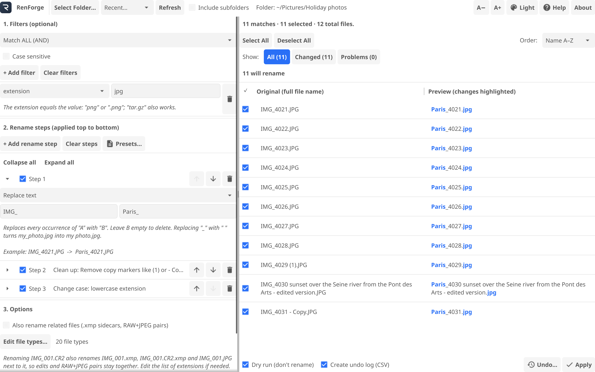
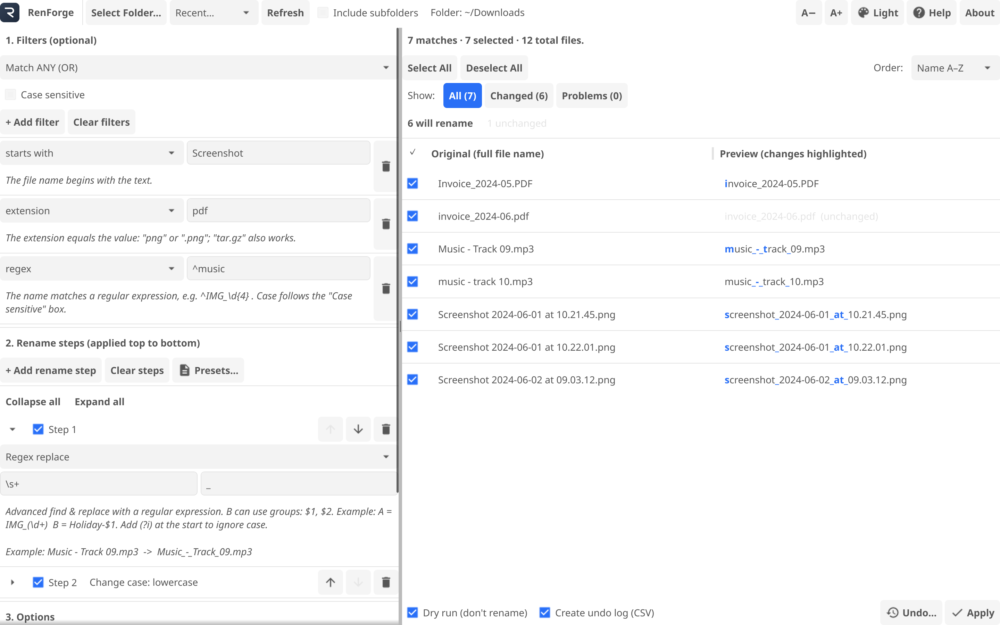
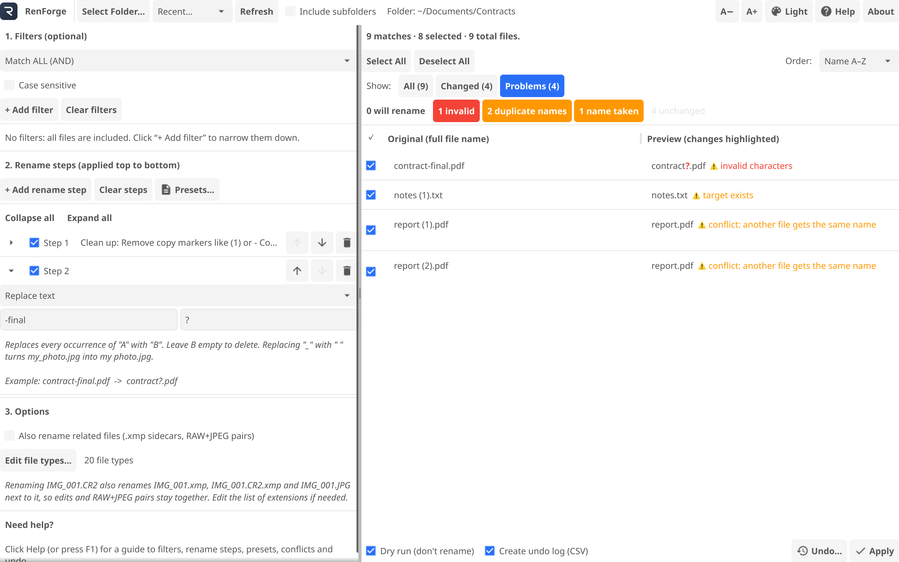

# RenForge (File Rename Utility)

A lightweight desktop utility (built with **Go + Fyne**) to **filter files** and **preview bulk renames** before applying them.

- Website : https://renforgeapp.web.app (documentation with examples: [renforgeapp.web.app/docs.html](https://renforgeapp.web.app/docs.html))
- Repo: https://github.com/blackarck/renforge
- Download : https://github.com/blackarck/RenForge/releases/tag/latest
- User guide: [docs/USER_GUIDE.md](docs/USER_GUIDE.md) (also built into the app: **Help** button or **F1**)
- Report a bug / request a feature: [Issues](https://github.com/blackarck/renforge/issues/new/choose) · Contribute: [CONTRIBUTING.md](CONTRIBUTING.md)
- [](https://youtu.be/x36PhFQ_yCY)

---

## Features

### Folder selection

- Select a folder with the **Select Folder…** button or pick from the **recent folders** dropdown (last 5 folders remembered across sessions)
- Toggle **Include subfolders** to scan recursively into subdirectories
- Hit **Refresh** to reload the current folder after external changes

### Multiple filters (AND/OR)

Add one or more filter rules to narrow down which files are shown:

| Mode | Example |
|---|---|
| `starts with` | `The` |
| `contains` | `Whale` |
| `ends with` | `.mp3` |
| `extension` | `png` |
| `regex` | `^IMG_\d{4}` |

- **Match ALL (AND)** or **Match ANY (OR)**
- **Case sensitive** toggle

### Rename preview pipeline

Add multiple rename steps — the preview updates live as you type:

| Step | Description |
|---|---|
| Remove text | Removes a substring from the filename |
| Replace text | Replaces one substring with another |
| Insert before extension | Inserts text just before the file extension |
| Append | Appends text before the extension |
| Prepend | Prepends text at the start of the filename |
| Change extension | Replaces the file extension |
| Regex replace | Pattern find & replace with capture groups (`$1`) |
| Change case | lower / UPPER / Title / Sentence / snake_case / kebab-case, or the extension's case |
| Clean up | Collapse spaces, trim, remove accents, dots/underscores to spaces, drop `(1)` / `- Copy` |
| Number files | Sequence numbers from a template such as `Trip_{n:4}`, with start and step |
| Rename from template | Names from EXIF capture date, camera, number, folder: `{date:YYYY-MM-DD}_{n:3}` |
| Shift frame numbers | Adds an offset to the frame number at the end of a name (`shot.0001.exr` → `shot.1001.exr`) |

Steps are applied in order, top to bottom. Each step can be switched off with its checkbox or moved with the ▲ ▼ buttons.

### Per-file selection

- Changed text is **highlighted** in the preview, the two columns can be resized by dragging the divider, and a summary line counts what will rename, what is invalid, duplicated or taken (click a count to see those files)
- **Show: All / Changed / Problems** narrows the preview to what will change or what needs fixing, with live counts
- Every matched file has a **checkbox** in the preview — uncheck any file to exclude it from the rename
- **Select All** / **Deselect All** buttons for quick bulk toggling
- The header shows a live count: `Showing 1–10 of 42 matches · 38 selected · 100 total files`

### Large folders

The preview is a virtualized list, so it stays smooth with tens of thousands of files. Long names wrap instead of being cut off, **A−** / **A+** change the text size, and **Auto / Light / Dark** switch the colours. Window size, panel widths and these settings are remembered. Folders are scanned in the background (with natural sort order: `img2` before `img10`), and renaming runs in the background too.

### Photos, sequences and related files

- **Rename from template**: names from the photo's capture date (EXIF), camera, lens, ISO, number, folder: `{date:YYYYMMDD_HHmmss}_{n:3}`. Works for JPEG and TIFF-based RAW; other files use their modified date.
- **Shift frame numbers**: `shot.0001.exr` → `shot.1001.exr` for render and image sequences. Chained renames (frame 1→2, 2→3) are handled safely.
- **Related files**: renaming `IMG_001.CR2` also renames `IMG_001.xmp`, `IMG_001.CR2.xmp` and `IMG_001.JPG`, all or none.
- **Order** by name, date or size; optional per-folder numbering; **drag a folder** onto the window to open it.

### Presets

Save your filters and rename steps under a name and reload them later with **Presets…**. Built-ins: *Clean up downloads*, *Lowercase names and extensions*, *kebab-case names*, *Photos: Trip_0001*, *Photos by date*, *Photos by date and time*, *Image sequence: start at frame 1001*, *Add number suffix*. Presets are JSON files in your user config folder.

### Safety-first apply

Before renaming, RenForge validates every planned rename and warns about:

- **Invalid names** — empty names, invalid or control characters, leading/trailing spaces, trailing dots, names over 255 bytes, Windows reserved names (CON, NUL, etc.)
- **Duplicate conflicts** — two selected files would become the same name
- **Target exists on disk** — the destination filename already exists

Problematic files are **skipped**; only safe renames proceed.

### Two-phase rename

Renames are executed in two phases — files move to a temporary name first, then to the final name. This makes swap-style renames (`a → b` and `b → a`) and case-only renames (`IMG.jpg → img.jpg`) safe without either file clobbering the other. Existing files are never overwritten, and any file left under a temporary name is reported.

### Dry Run / Apply

- **Dry run** (default) generates the rename plan and shows results without touching any files
- **Apply** executes the renames

### Undo Log (CSV) and one-click Undo

Optional CSV log with one row per file, written *after* the rename so it records what really happened:

`old_path`, `new_path`, `old_name`, `new_name`, `status`, `reason`

Click **Undo…** to restore the original names from a log (the most recent one is offered automatically). Files that were moved, deleted or whose original name is in use again are reported and skipped.

### Built-in help

- **Help** button / **F1**: tabbed guide (quick start, filters, rename steps, safety & undo, tips). Shown automatically on first launch.
- Every filter mode and rename step has a short explanation with an example right in the panel.
- Helpful empty states tell you what to do next.

---

## Screenshots

**Rename steps with a live preview** (the changed part of each new name is highlighted):



**Filters** (contains, starts with, extension, regex) combined with AND / OR:



**Safety checks**: invalid names, duplicate names and taken names are counted and flagged before anything is renamed:



---

## Install / Download

Download a pre-built binary for your platform from the latest release:
https://github.com/blackarck/RenForge/releases/tag/latest

> **Signing status:** macOS builds are signed (and notarized when the release secrets are configured). Windows builds are not signed yet, so SmartScreen may warn: choose *More info → Run anyway*. See [docs/RELEASING.md](docs/RELEASING.md).

---

## Build & Run

### Prerequisites

- Go (recommended: latest stable)
- Fyne platform dependencies

Fyne setup: https://developer.fyne.io/started/

### Run locally

```bash
go run .
```

### Build binary

```bash
go build -o renforge .
```

A plain `go build` has no app icon, and on Windows it opens a console window. For a proper app bundle / executable with the icon (uses `FyneApp.toml` and `icon.png`):

```bash
go install fyne.io/tools/cmd/fyne@latest
fyne package -os darwin      # or: windows, linux
```

### Run the tests

The rename engine is UI-free and fully unit-tested:

```bash
go test ./internal/...
```

### Project layout

```
renforge.go, rows.go, presets.go, help.go, icon.go   Fyne user interface, in-app help, window icon
internal/rename        step pipeline, name validation, plan building, two-phase apply
internal/filter        filter rules
internal/undo          undo log (CSV) reading, writing and reverting
internal/meta          cached file size / dates / EXIF (github.com/rwcarlsen/goexif)
internal/preset        saved and built-in presets (JSON)
docs/USER_GUIDE.md     user documentation
docs/RELEASING.md      releases and code signing
icon.svg / icon*.png   application icon (source and renderings)
```

---

## Contributing & support

- **Found a bug?** [Open an issue](https://github.com/blackarck/renforge/issues/new/choose) with your OS, which build you used, the steps to reproduce, and what you expected.
- **Have an idea?** Open a *Feature request* with example file names before and after.
- **Want to contribute code?** Fork, branch, add tests, open a pull request. See [CONTRIBUTING.md](CONTRIBUTING.md) for the full checklist and how to build.
- **Questions about using it?** Read the [documentation](https://renforgeapp.web.app/docs.html) or press **F1** in the app.

---

## Roadmap

- EXIF for HEIC and CR3, GPS/location tokens
- Column sorting and highlighted diffs in the preview
- Command-line mode / export plan as shell script

---

## License

RenForge is licensed under a dual-license model:

- **Non-commercial use**: Free under [CC BY-NC 4.0](https://creativecommons.org/licenses/by-nc/4.0/)
- **Commercial use**: Requires a paid commercial license

For commercial licensing, contact: blackarck@gmail.com
